# Eshopify

A fully modern, premium e-commerce mobile app UI built with Flutter. The experience blends **Shopify-style merchant polish** with **Amazon-style product discovery and utility**, focused on clean browsing, strong conversion patterns, and a professional checkout flow.

> **Note:** This project uses **placeholder/mock data only**. There are no real backend services, authentication providers, payment gateways, Shopify APIs, or Amazon APIs connected.

## Highlights

- Material 3 design system with **light and dark themes**
- Clean, scalable **feature-first** architecture
- `go_router` navigation with shell-based bottom navigation
- Premium UI patterns: onboarding, auth, promos/deals, discovery, product detail, cart, checkout, order confirmation/tracking, wishlist, search, notifications, and settings
- Reusable core widgets and in-memory mock data/state
- Responsive layouts, subtle animations, loading skeletons, and empty states
- Conversion-focused UX (prominent pricing/discounts/ratings/delivery, sticky CTAs, clear checkout)

## Tech stack

- **Flutter** (Dart 3, null safety) + **Material 3**
- **Navigation:** `go_router`
- **Typography:** `google_fonts`
- **UI/media:** `cached_network_image`, `flutter_svg`, `shimmer`, `flutter_animate`, `flutter_rating_bar`, `badges`
- **Utils:** `intl`

## Screenshots

| | | |
|---|---|---|
| **Onboarding**<br>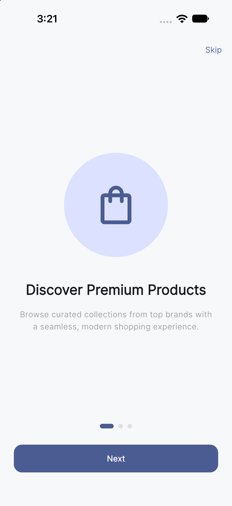 | **Welcome**<br>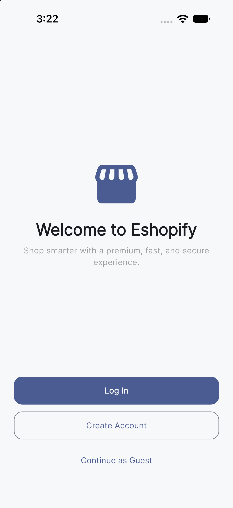 | **Login**<br>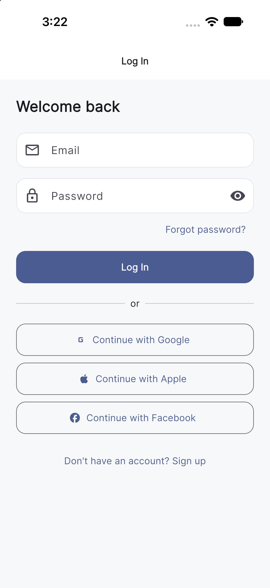 |
| **Sign Up**<br>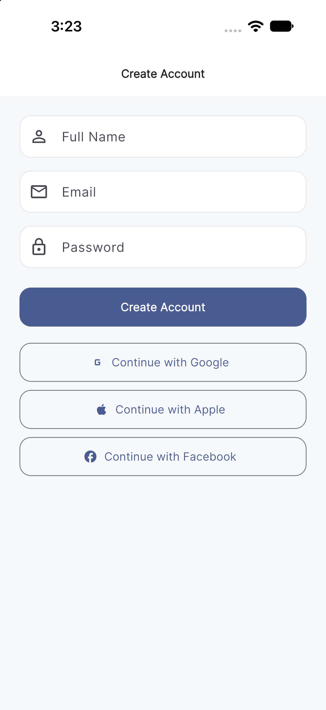 | **Forgot Password**<br>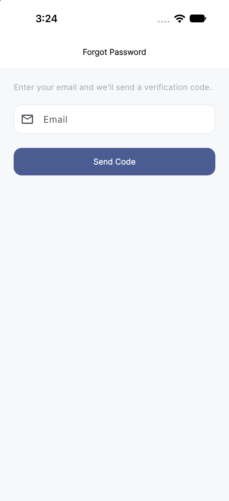 | **OTP Verification**<br>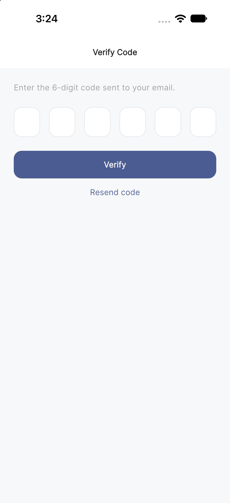 |
| **Home**<br>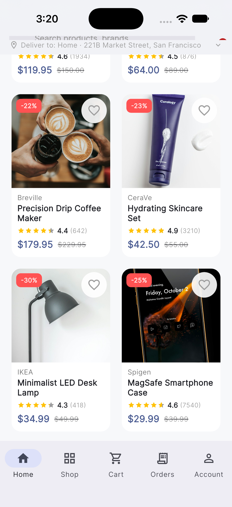 | **Catalog / Shop**<br>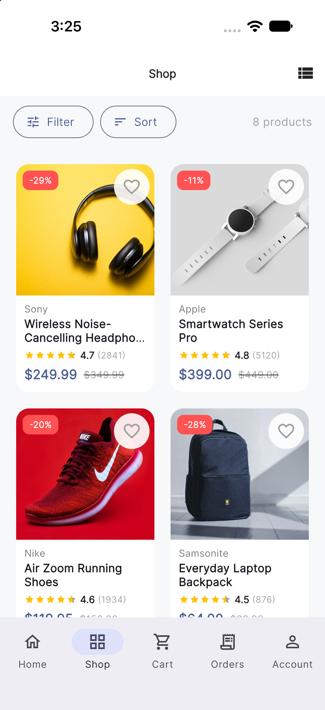 | **Search**<br>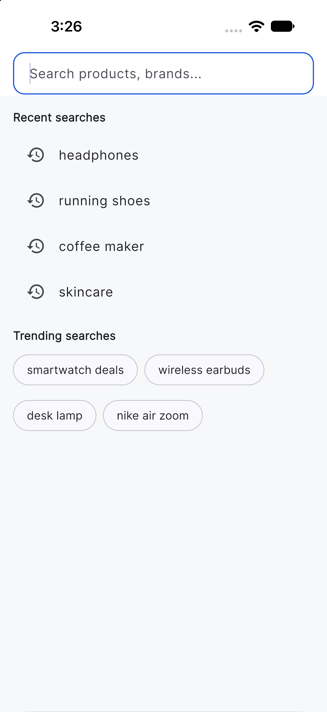 |
| **Product Detail**<br>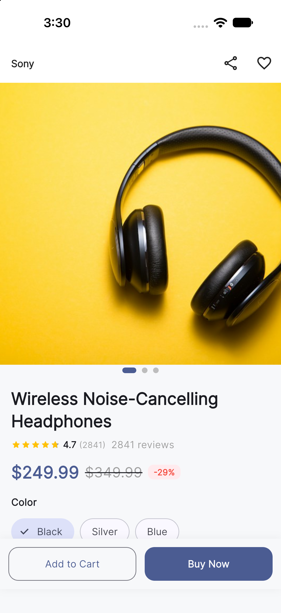 | **Cart**<br>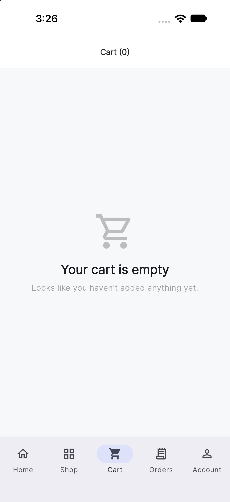 | **Wishlist**<br>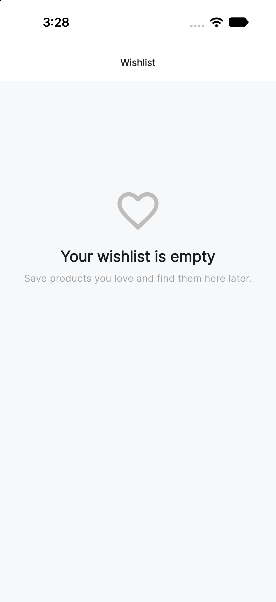 |
| **Checkout**<br>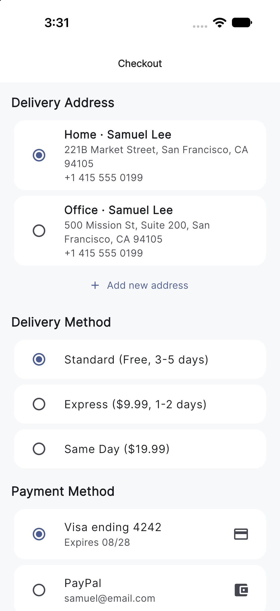 | **Order Confirmation**<br>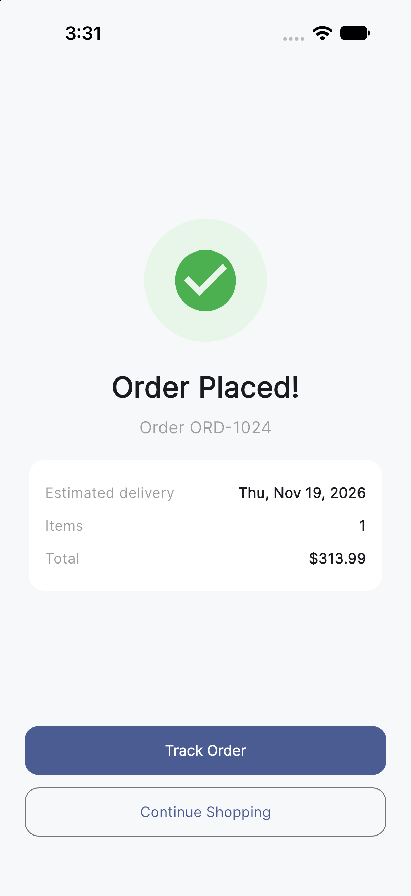 | **Orders**<br>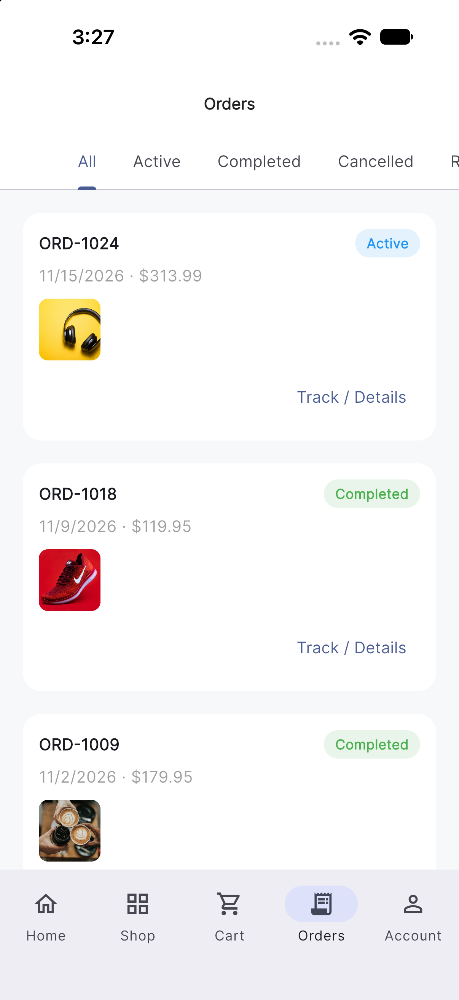 |
| **Order Detail**<br>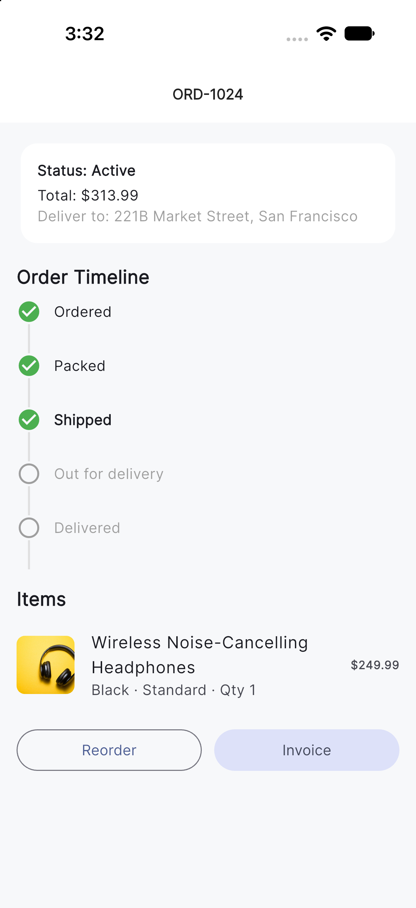 | **Order Tracking**<br>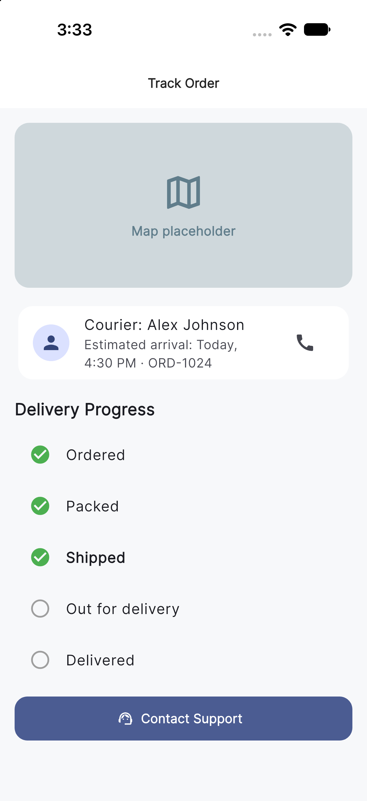 | **Account**<br>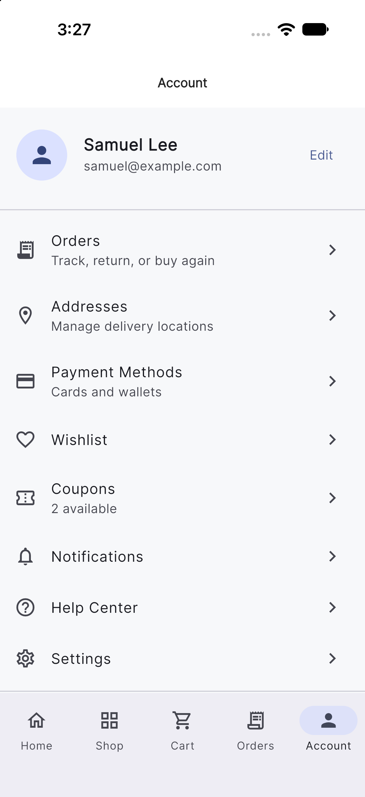 |
| **Addresses**<br>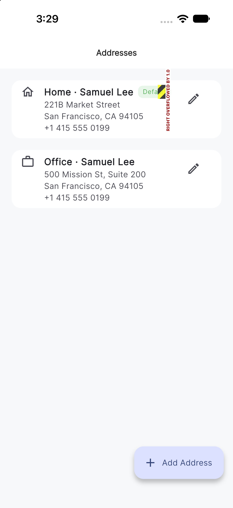 | **Payment Methods**<br>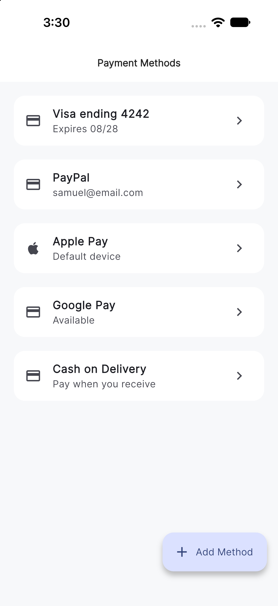 | **Notifications**<br>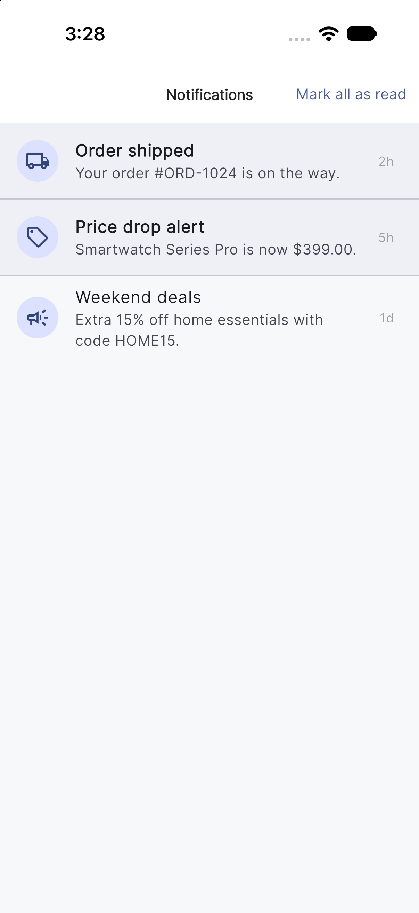 |
| **Settings**<br>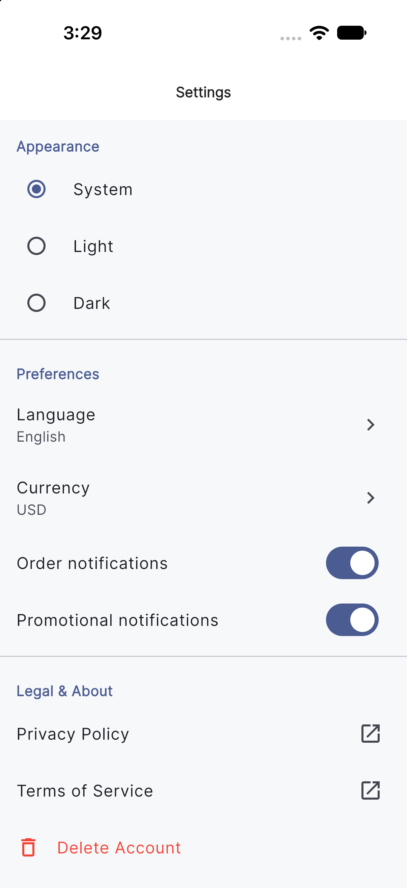 | | |

> Screenshots captured from the iOS Simulator (iPhone). Actual appearance may vary by device, theme, and platform.

## Implemented screens

1. **Onboarding** – 3 swipeable pages, skip, get started
2. **Authentication (UI only)** – welcome, sign up, login, forgot password, social buttons (Google/Apple/Facebook), OTP verification
3. **Home** – search entry, delivery selector, promo carousel, categories, flash deals countdown, trending/recommended/new arrivals, top brands, bottom navigation
4. **Catalog/Category** – filters & sort, grid/list toggle, product count, product cards, filter/sort bottom sheets
5. **Product Detail** – image gallery with zoom/swipe, pricing/discounts, ratings, variants, quantity, delivery/returns, expandable description, specs, reviews, related products, sticky actions
6. **Cart** – item management, quantity stepper, remove/save-for-later, promo code, order summary, empty state
7. **Checkout** – address selection/add form, delivery & payment methods, add-card form, order summary, place order
8. **Order Confirmation** – success state, order number, ETA, summary, track/continue actions
9. **Orders** – All/Active/Completed/Cancelled/Returns tabs, order cards, detail with status timeline, reorder/invoice actions
10. **Order Tracking** – map placeholder, delivery timeline, courier details, ETA, contact support
11. **Wishlist** – saved products, move to cart, remove, empty state
12. **Search** – recent/trending searches, suggestions/results grid, no-results state
13. **Account/Profile** – profile header, orders/addresses/payments/wishlist/coupons/notifications/help/settings/logout
14. **Notifications** – order updates, promos, price-drop alerts, mark all as read, empty state
15. **Settings** – theme mode (system/light/dark), language, currency, notification preferences, legal links, delete account, app version

## Project structure

```text
lib/
  core/
    mock/                 # Models and placeholder/mock data
    router/               # go_router configuration and app shell
    state/                # Lightweight app state (cart, wishlist, theme, orders, etc.)
    theme/                # Material 3 light/dark themes
    widgets/              # Reusable UI components
  features/
    account/presentation/        # Profile, addresses, payment methods
    auth/presentation/           # Welcome, login, signup, forgot password, OTP
    cart/presentation/           # Cart screen
    catalog/presentation/        # Category/catalog browsing, filter/sort
    checkout/presentation/       # Checkout and order confirmation
    home/presentation/           # Home/discovery experience
    notifications/presentation/  # Notifications inbox
    onboarding/presentation/      # Onboarding flow
    orders/presentation/         # Orders list/detail/tracking
    product/presentation/        # Product detail
    search/presentation/         # Search and results
    settings/presentation/       # App settings
    wishlist/presentation/       # Wishlist
  main.dart
screenshots/              # App page screenshots used in this README
```

## Core reusable widgets

Located in `lib/core/widgets/common_widgets.dart`: `PrimaryButton`, `SecondaryButton`, `CustomTextField`, `ProductImage`, `PriceText`, `RatingStars`, `QuantityStepper`, `SectionHeader`, `EmptyState`, `LoadingSkeleton`, `ProductCard`, and shared UI building blocks used across screens. Additional UI patterns (filter/sort sheets, address/payment tiles, timelines, badges, etc.) are implemented within feature screens and can be extracted further as the app grows.

## Mock data & local state

- **Mock data:** `lib/core/mock/models.dart`, `lib/core/mock/mock_data.dart`
  - Products, categories, brands, variants, reviews, orders, addresses, payment methods, promotions, notifications, and search suggestions
- **Local app state:** `lib/core/state/app_state.dart`
  - Theme mode, cart/wishlist, orders, addresses, payments, notifications, preferences
  - All user actions (add to cart, place order, favorites, etc.) operate on in-memory mock/local state

## Getting started

### Prerequisites
- [Flutter SDK](https://docs.flutter.dev/get-started/install) (Dart 3 compatible)
- A device/emulator/simulator or Chrome (for web)

### Run locally

```bash
flutter pub get
flutter run
```

To analyze and test:

```bash
flutter analyze
flutter test
```

> Tip: for development/screenshots you can deep-link to a route with `--dart-define=INITIAL_ROUTE=/home` (supports routes like `/product/p1`, `/orders`, etc.).

## Where to connect a real commerce backend later

- **Data/contracts:** replace mock models and sources in `lib/core/mock/` with domain entities, DTOs, and repository interfaces.
- **State/data flow:** evolve `lib/core/state/app_state.dart` into feature-specific controllers/notifiers/blocs and repositories (e.g. `data/`, `domain/`, `application/` layers per feature).
- **Networking:** add an API client/service layer (Dio/http/GraphQL) and environment configuration.
- **Products/catalog/search:** connect catalog, search suggestions, pricing, inventory, and reviews endpoints.
- **Cart/checkout/orders:** persist cart server-side (or hybrid), validate pricing/promos, create orders, and fetch order history/tracking.
- **User/profile:** load/save addresses, payment preferences, wishlist, and notifications from backend services.

## Where to add integrations later

- **Shopify:** add a Shopify Storefront/Admin integration in a dedicated data/repository layer (e.g. `lib/features/catalog/data/`, `lib/features/checkout/data/`) for products, collections, cart/checkout, and orders.
- **Stripe:** integrate Stripe PaymentSheet/Elements via Flutter plugins in checkout/payment flows (`lib/features/checkout/`) with secure server-side intent creation.
- **PayPal:** add PayPal SDK/buttons in checkout payment selection (`lib/features/checkout/`) backed by server-created orders/captures.
- **Firebase:** add Firebase Auth, Cloud Firestore/RTDB, Cloud Functions, FCM, Analytics/Crashlytics for auth, user data, notifications, and observability (initialize in `main.dart` and inject services per feature).

## UX notes included in this UI demo

- Add-to-cart feedback (snackbar/actions) and cart badge/count updates
- Favorite toggling, image zoom/swipe, promo/carousel interactions
- Skeleton loaders, pull-to-refresh, and empty states for key flows
- Form validation UI for auth/checkout inputs (no real processing)
- Clear, conversion-focused pricing, delivery, and checkout presentation

## Disclaimer

This is a **UI/UX prototype** with mock/local behavior only. Do not use as-is for production payments, authentication, or order fulfillment without implementing secure backend services, compliance, and proper testing.
